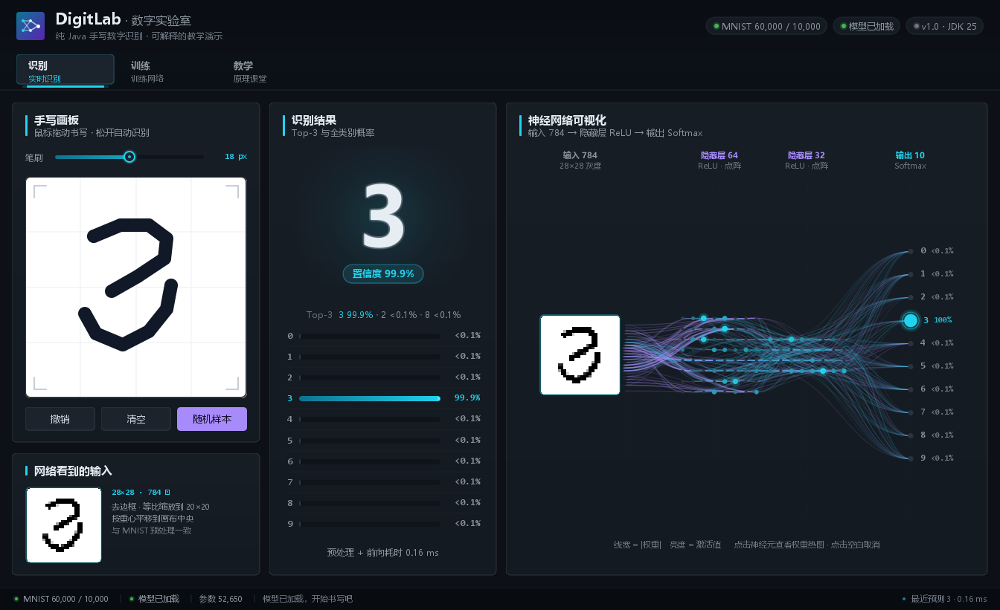
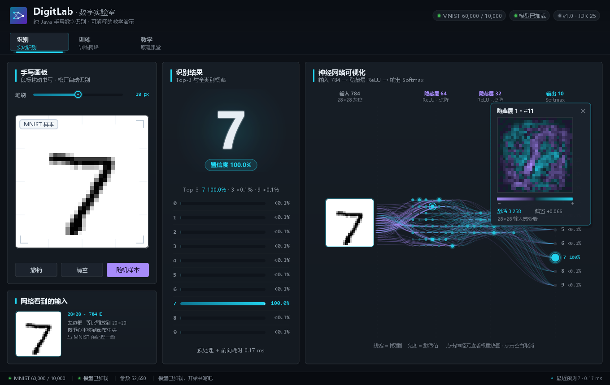
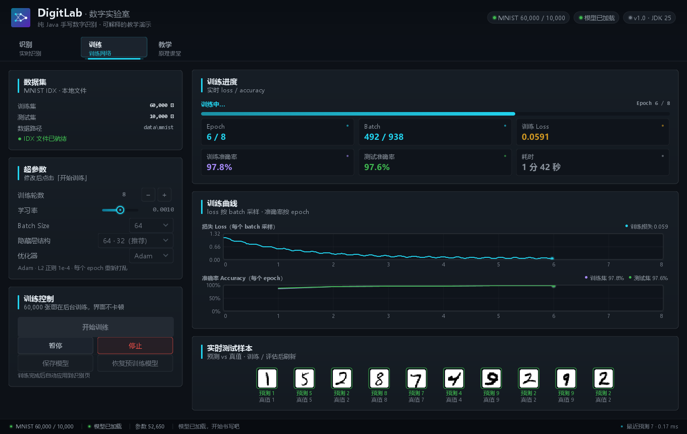
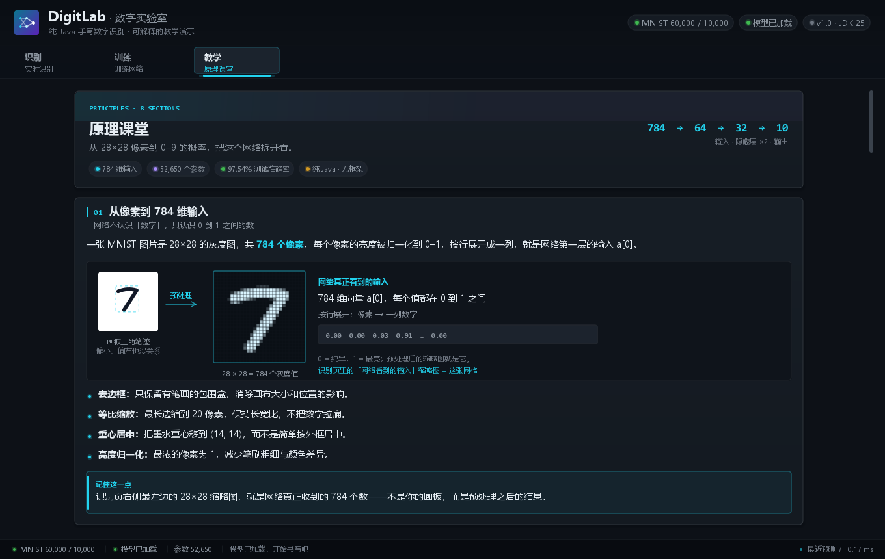

# DigitLab · 数字实验室

> 用**纯 Java 从零实现**一个手写数字识别 AI，并配上可交互的图形界面和神经网络可视化。
> 没有 TensorFlow / PyTorch / DJL，也没有任何第三方依赖——前向传播、反向传播、Softmax、Adam 优化器全部手写。



DigitLab 是一个面向**教学与自学**的项目：你可以在左侧画板写一个数字，看到网络实时给出的 0–9 概率；
右侧会画出 784 → 64 → 32 → 10 的神经网络，显示每个神经元的激活、每条连接的权重强度；
还可以在「训练」页亲手启动训练，观察损失和准确率如何变化。

---

## ✨ 功能亮点

- **从零实现 MLP**：Dense 层、ReLU、Softmax、交叉熵、反向传播、Adam/SGD，全部是可读的 Java 代码。
- **即写即识别**：鼠标在画板上写数字，自动完成 MNIST 风格预处理并实时推理。
- **神经网络可视化**：逐层显示 28×28 输入、隐藏层节点、输出概率；边宽映射权重、亮度映射激活；预测路径有流动光点动画。
- **可交互教学**：点击任意神经元，查看它「学到」的权重热图；直观理解每个神经元在寻找什么特征。
- **训练过程可视化**：实时 loss/accuracy 曲线、epoch/batch 进度、测试样本预测结果；支持暂停、停止、保存模型。
- **自带数据和预训练模型**：开箱即用；MNIST 完整 60,000 训练 / 10,000 测试，预训练模型测试准确率 **97.54%**。
- **纯 JDK**：只需要 JDK 17+，Swing + Java2D 构建界面，无构建工具、无网络依赖。

### 界面一览

| 识别 + 神经网络可视化 | 点击神经元查看权重 |
|---|---|
|  |  |
| **训练过程可视化** | **原理课堂** |
|  |  |

## 🚀 快速开始

环境要求：**JDK 17 或更高版本**（已在 JDK 25 上验证）。不需要 Maven/Gradle。

### Windows

双击 `build.bat` 编译，再双击 `run.bat` 启动。也可以在命令行里：

```bat
build.bat
run.bat
```

### macOS / Linux / Git Bash

```bash
chmod +x build.sh run.sh train.sh
./build.sh
./run.sh
```

### 直接运行已编译的 jar

```bash
java -jar digit-ai.jar
```

项目已包含：

```
data/mnist/            完整的 MNIST IDX 文件
models/digit-mlp.bin   预训练模型（784-64-32-10，测试集 97.54%）
```

首次启动会自动找到它们。如果数据或模型丢失，见下文「常见问题」。

## 🖱️ 怎么玩

### 识别页

1. 在左边白色画板里用鼠标写一个 **0–9** 的数字，尽量写大、写粗，居中一点。
2. 中间会显示第一个预测结果、置信度、Top-3 和 10 个数字的概率条。
3. 右边是神经网络：
   - 节点亮度 = 激活值，边粗细/亮度 = 权重绝对值；
   - 从输入到输出的脉冲动画展示本次前向传播；
   - **点击隐藏层或输出层的任意神经元**，会显示与它相连的权重热图，看看它对应什么笔画特征；
   - 点击「随机样本」可以直接加载一张 MNIST 测试图片，对比模型表现。
4. 快捷键：`C` 清空画板，`Ctrl+Z` 撤销，`R` 随机样本。

> 为什么有时识别不准？手写风格和 MNIST 差异很大时（例如非常细的笔画、写得太小、数字倾斜严重），
> 模型确实会犯错。这正是教学讨论的好素材：数据分布、预处理、模型容量都会影响结果。

### 训练页

1. 选择 epochs、学习率、batch size、隐藏层大小和优化器。
2. 点击「开始训练」。数据在后台线程加载，界面不会卡住。
3. 观察 loss / accuracy 曲线，以及右侧测试样本的实时预测。
4. 训练完成后会立即在测试集上评估，并自动把新模型应用到识别页（同一 `Network` 实例）。
5. 点击「保存模型」可把当前网络写入 `models/digit-mlp.bin`；支持暂停、停止、恢复预训练模型。

默认参数（Adam，lr=0.001，batch=64，8 epochs，隐藏层 64/32）在普通笔记本上约 20–30 秒完成
（本机 10 epochs 约 28 秒；训练速度取决于 CPU）。

### 教学页

内置中文图文讲解：28×28 输入、全连接层与 ReLU、Softmax、交叉熵、反向传播、梯度下降、预处理为什么重要，
以及推荐的课堂演示流程。

## 🧠 模型与原理

```
输入 784 (28×28)  →  隐藏层 64 (ReLU)  →  隐藏层 32 (ReLU)  →  输出 10 (Softmax)
参数量：784×64 + 64 + 64×32 + 32 + 32×10 + 10 = 52,650
```

- **前向传播**：`z = W·a + b`，隐藏层用 ReLU，输出层用 Softmax 得到 10 个概率。
- **损失函数**：交叉熵 `L = -log(p[y])`。
- **反向传播**：Softmax + 交叉熵的组合让输出层误差简化为 `p - onehot`，再逐层回传。
- **优化器**：Adam（默认）或 SGD，支持 L2 正则、mini-batch、He 初始化。
- **预处理**：画板 → 灰度墨水 → 裁掉空白 → 等比缩放到 20×20 → 重心居中到 28×28 → 亮度归一化，
  让鼠标输入尽量接近 MNIST 的分布。

训练与评估都是纯 Java 循环，没有向量化库；60,000 张图一个 epoch 在本机约 2.6–2.8 秒。

## 📁 项目结构

```
digit-ai/
├── src/main/java/digitai/
│   ├── Main.java                 程序入口（GUI / 命令行分发）
│   ├── nn/                       神经网络核心
│   │   ├── Network.java          手写 MLP：前向、反向、Adam、模型存取
│   │   ├── Trainer.java          epoch/batch 训练循环与回调
│   │   ├── ForwardTrace.java     一次前向的完整激活轨迹（可视化用）
│   │   ├── TrainConfig.java      超参数
│   │   ├── Evaluation.java       准确率与混淆矩阵
│   │   └── ...
│   ├── data/
│   │   ├── MnistLoader.java      IDX / gzip 读取
│   │   ├── Preprocessor.java     画板 → 28×28 输入
│   │   ├── Dataset.java          数据集
│   │   └── AppPaths.java         数据/模型路径解析
│   ├── ui/                       Swing 界面（识别 / 训练 / 教学）
│   └── tools/                    命令行工具（训练、评估、预测、下载）
├── data/mnist/                   MNIST 数据
├── models/digit-mlp.bin          预训练模型
├── docs/                         截图、API 文档、原理说明（ARCHITECTURE.md）
├── build.bat / build.sh          构建脚本
├── run.bat / run.sh              启动脚本
└── train.bat / train.sh          命令行训练脚本
```

更详细的算法推导、代码阅读顺序和课堂实验建议见 **[docs/ARCHITECTURE.md](docs/ARCHITECTURE.md)**。

## ⌨️ 命令行

```bash
# 训练（参数可省略，默认 8 epochs、64/32 隐藏层、Adam）
java -cp out/classes digitai.Main train --epochs 10 --hidden 64,32 --lr 0.001

# 用其他隐藏层结构训练
java -cp out/classes digitai.Main train --hidden 128,64 --epochs 12 --out models/big.bin

# 在测试集上评估
java -cp out/classes digitai.Main eval --model models/digit-mlp.bin --limit 10000

# 识别一张白底黑字图片
java -cp out/classes digitai.Main predict my-digit.png

# 数据丢失时下载 MNIST
java -cp out/classes digitai.Main download
```

训练日志会逐 epoch 打印 loss、训练准确率、测试准确率和耗时，并把模型保存到 `models/`。

## 📊 预训练模型指标

在 MNIST 官方 10,000 张测试集上：

| 指标 | 数值 |
|---|---|
| 准确率 | **97.54%**（9,754 / 10,000） |
| 参数量 | 52,650 |
| 结构 | 784 → 64 → 32 → 10 |
| 训练 | Adam，lr=0.001，batch=64，10 epochs |

每个数字的准确率：

| 数字 | 0 | 1 | 2 | 3 | 4 | 5 | 6 | 7 | 8 | 9 |
|---|---|---|---|---|---|---|---|---|---|---|
| 准确率 | 98.27% | 99.38% | 96.12% | 98.02% | 97.86% | 97.65% | 97.60% | 97.57% | 95.48% | 97.22% |

## ❓ 常见问题

**Q: 启动提示“未加载模型”，识别不可用？**
A: `models/digit-mlp.bin` 不存在或损坏。进入训练页点击「开始训练」重新训练，或执行
`java -cp out/classes digitai.Main train`。也可以用「恢复预训练模型」重新加载。

**Q: 训练页提示找不到 MNIST 数据？**
A: 确认 `data/mnist/` 下有 4 个 IDX 文件（或 `.gz`），或执行
`java -cp out/classes digitai.Main download`。也可以用 `-Ddigitai.data=<目录>` 指定数据目录。

**Q: 没有图形桌面（服务器 / SSH）怎么办？**
A: 使用命令行 `train` / `eval` / `predict`。GUI 需要桌面环境。

**Q: 控制台中文乱码？**
A: Windows 旧版控制台不是 UTF-8。使用 Windows Terminal，或先执行 `chcp 65001`；
命令行训练脚本已经加上 `-Dstdout.encoding=UTF-8`。

**Q: 为什么不用 Maven/Gradle？**
A: 这个项目的目标之一就是“从零、无依赖”。`javac` + `jar` 足够，构建脚本只有几行，便于阅读和教学。

**Q: 可以换成卷积网络吗？**
A: 可以，但本项目的教学重点是“一个完整、透明、可调试的全连接网络”。784-64-32-10 的全部参数都能在界面里看到，
比黑盒 CNN 更适合讲清楚前向/反向传播。想继续挑战的话，可以在 `nn/` 下增加 LeakyReLU、Dropout、动量等。

## 📚 数据来源

- MNIST 手写数字数据集：Yann LeCun 等，<http://yann.lecun.com/exdb/mnist/>。
- 本项目通过公开镜像下载 IDX 文件并随仓库附带，仅供教学使用。

## 📄 License

仅用于学习与教学。代码可自由修改、用于课堂演示。
